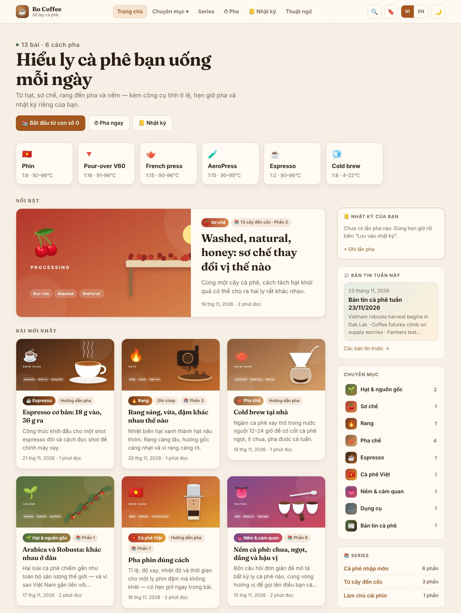
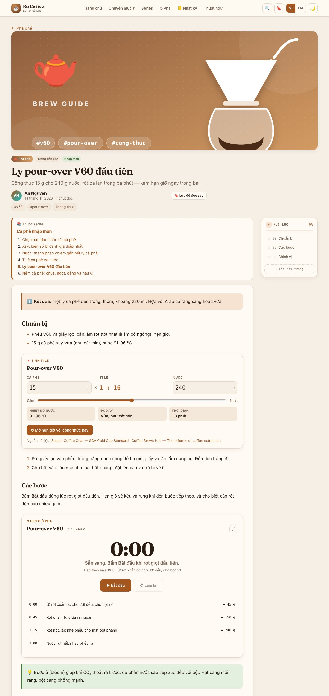
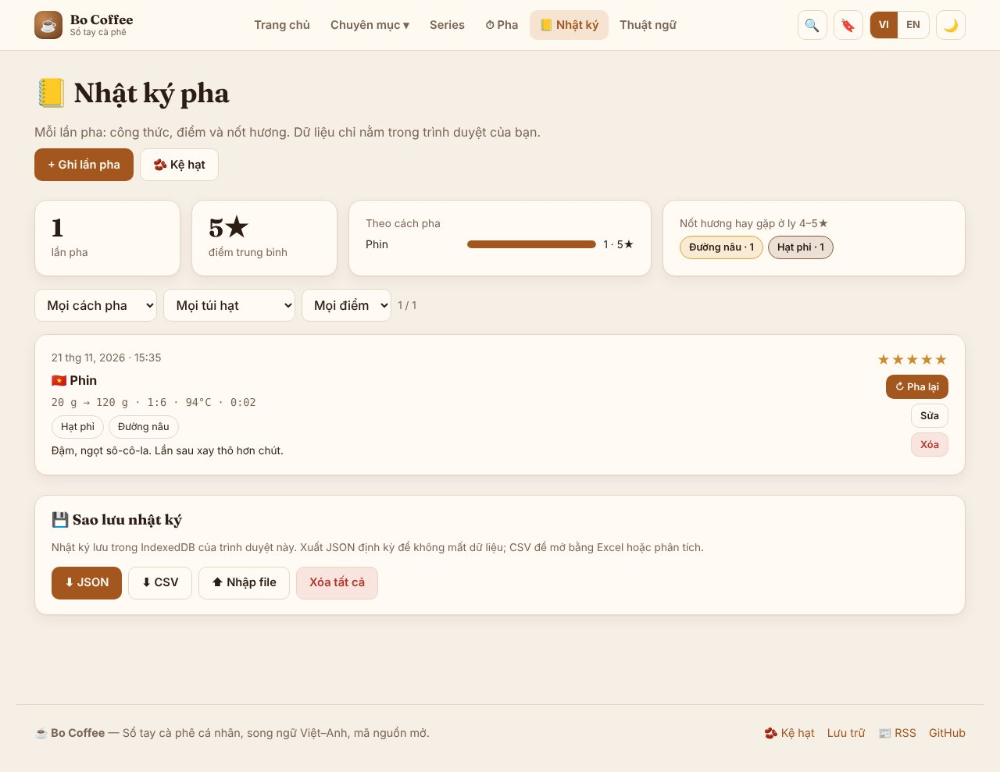
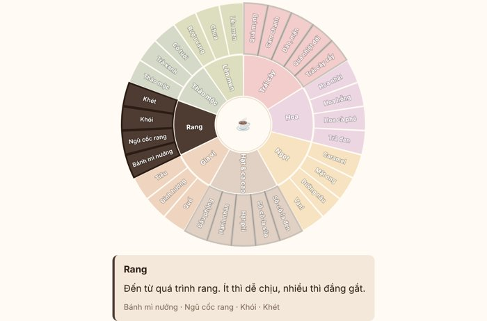
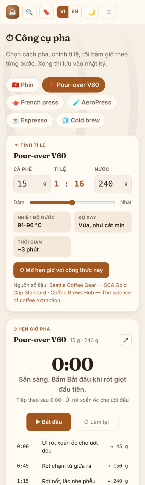
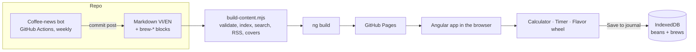

# Bo Coffee — Sổ tay cà phê / Coffee Notebook ☕

> 🇻🇳 Sổ tay kiến thức cà phê song ngữ Việt–Anh: hạt, sơ chế, rang, pha và nếm. Mỗi bài hướng dẫn có **máy tính tỉ lệ** và **hẹn giờ pha** chạy ngay trong bài; bạn có **kệ hạt** và **nhật ký pha** riêng, lưu trong trình duyệt. Một bot tổng hợp tin cà phê mỗi tuần.
>
> 🇺🇸 A bilingual (VI/EN) coffee notebook: beans, processing, roasting, brewing and tasting. Every brew guide has a **ratio calculator** and a **step timer** right inside the article; you also get a personal **bean shelf** and **brew journal** stored in your browser. A bot compiles coffee news every week.

    

**Live:** https://hoangan-bonieeror.github.io/bo-coffee/



---

## ✨ Tính năng / Features

| | Tính năng | Feature |
|---|---|---|
| 📚 | **12 bài song ngữ** trong 8 chuyên mục, 3 series (Cà phê nhập môn, Từ cây đến cốc, Làm chủ cái phin) | **12 bilingual posts** across 8 topics and 3 series |
| 🧮 | **Máy tính tỉ lệ** trong bài: sửa gam cà phê hoặc nước, kéo tỉ lệ đậm–nhạt; kèm nhiệt độ, độ xay, thời gian và nguồn số liệu | **In-article ratio calculator**: edit coffee or water, drag strength; shows temperature, grind, time and sources |
| ⏱ | **Hẹn giờ pha** từng bước: lượng nước cần rót cộng dồn, kêu và rung khi sang bước, giữ màn hình sáng, chế độ toàn màn hình | **Step brew timer**: cumulative pour targets, beep + vibrate per step, screen wake lock, focus mode |
| 🎨 | **Vòng hương vị** tự vẽ (SVG) 8 nhóm, 31 nốt: đọc mô tả hoặc chọn nốt khi ghi nhật ký | **Flavor wheel** (hand-built SVG), 8 families and 31 notes: read about them or pick notes when logging |
| 🫘 | **Kệ hạt**: nguồn gốc, loài, sơ chế, mức rang, ngày thứ mấy sau rang, lượng còn lại trong túi | **Bean shelf**: origin, species, process, roast level, days since roast, grams left |
| 📒 | **Nhật ký pha**: công thức, điểm, nốt hương; thống kê theo cách pha, nốt hay gặp ở ly 4–5★; **Pha lại** một chạm | **Brew journal**: recipe, rating, notes; stats by method, top notes in 4–5★ cups; one-tap **Brew again** |
| 🔬 | **Tính độ chiết xuất** từ TDS, so với vùng Gold Cup của SCA | **Extraction calculator** from TDS against the SCA Gold Cup zone |
| 💾 | Sao lưu/khôi phục JSON (có `schemaVersion`), xuất CSV để phân tích | JSON backup/restore (versioned), CSV export for analysis |
| 📖 | **Thuật ngữ**: 34 mục song ngữ, tìm không dấu, liên kết tới bài | **Glossary**: 34 bilingual terms, accent-insensitive search, linked to posts |
| 📰 | **Bản tin cà phê hằng tuần**: bot đọc RSS các trang tin cà phê, Gemini tóm tắt song ngữ | **Weekly coffee news**: a bot reads coffee news feeds; Gemini writes bilingual summaries |
| 🌗 | VI/EN chuyển tức thì, sáng/tối theo hệ điều hành, responsive, tôn trọng *Reduce motion* | Instant VI/EN, light/dark from the OS, responsive, honours *Reduce motion* |

| Bài hướng dẫn có công cụ / Guide with tools | Nhật ký / Journal | Điện thoại / Mobile |
|---|---|---|
|  |   |  |

---

## 🎨 Giao diện "Sài Gòn + Lab" / Design

Bo Coffee chạy cùng cơ chế với Bostu nhưng có giao diện riêng, ghép hai ý:

- **Quán cà phê Sài Gòn — bản sắc:** thanh menu đỏ như biển hiệu tráng men, viền vàng, dải gạch bông; trang chủ mở bằng *Thực đơn cách pha* trong đó "giá tiền" là tỉ lệ cà phê : nước; tiêu đề bài in trên một tấm biển men. Font tiêu đề Oswald, chữ thường Be Vietnam Pro.
- **Phòng thí nghiệm chiết xuất — số liệu:** mọi con số dùng JetBrains Mono; khung có viền góc; biểu đồ *Ly gần nhất* vẽ các lần pha có đo TDS theo tỉ lệ chiết xuất (vùng 18–22 %, thêm ô Gold Cup cho cách pha lọc); bảng *Thông số pha* cạnh bài có `method:`.

Toàn bộ lớp giao diện nằm trong `src/saigon-lab.scss` (nạp sau cùng, chỉ ghi đè token và component), nên muốn đổi phong cách chỉ cần sửa/bỏ file này. Có chế độ sáng (nền kem) và tối (nâu espresso) theo hệ điều hành; trên điện thoại có thanh điều hướng 4 mục ở đáy màn hình. Bản phác thảo nằm trên canvas thiết kế của dự án.

*The "Saigon + Lab" skin: a Saigon café menu board (red enamel sign, tiled strip, Oswald) carries the identity, an extraction lab (mono numbers, bracketed panels, an EY/TDS chart of your last cups) carries the data. It all lives in `src/saigon-lab.scss`, loaded last.*

## 🏗️ Kiến trúc / Architecture

Không có server. Nội dung là file Markdown trong git; dữ liệu cá nhân nằm trong trình duyệt. Chi phí vận hành: 0 đồng.
No server. Content is Markdown in git; personal data stays in the browser. Running cost: zero.



**Quyết định chính / Key decisions**

- **Markdown + fenced blocks thay vì CMS.** Một bài là hai file `.vi.md` / `.en.md`; khối ` ```brew-timer ` được `markdown.ts` biến thành chỗ trống, rồi trang bài viết gắn component Angular thật vào bằng `createComponent({ hostElement })`. Viết bài vẫn chỉ là viết văn bản.
- **IndexedDB thay vì localStorage** cho nhật ký: dữ liệu lớn dần, cần nhiều bảng và không bị giới hạn ~5 MB. Toàn bộ nhật ký được phản chiếu vào Angular signals nên lọc và thống kê là đồng bộ. Trình duyệt không có IndexedDB thì app vẫn chạy trong bộ nhớ.
- **Một nguồn số liệu:** mọi con số chuẩn (tỉ lệ, nhiệt độ, độ xay, thời gian) nằm trong `public/content/brew-presets.json` kèm trường `source`. Công cụ và bài viết đọc cùng một file.
- **Logic thuần, có test:** toán tỉ lệ, chiết xuất, hẹn giờ, parser khối, thống kê, CSV và kiểm tra file sao lưu nằm trong `core/brew.ts` và `core/journal.ts`, không phụ thuộc Angular.

---

## 🚀 Chạy local / Run locally

Yêu cầu / Requires **Node.js 22+**

```bash
npm install
npm start          # http://localhost:4200 (builds the content index first)
npm test           # unit tests (Vitest)
npm run build      # production build → dist/bo-coffee/browser
npm run content    # validate posts + rebuild index, search, RSS and auto covers
```

Tạo bài mới / New post:

```bash
npm run new-post -- --category=brewing --title="AeroPress ngược" --type=guide --method=aeropress --level=beginner
```

---

## ✍️ Viết bài / Writing posts

Mỗi bài là **hai file** trong `public/content/posts/`: `<id>.vi.md` và `<id>.en.md`.

```yaml
---
title: "Pha phin đúng cách"
summary: "Một câu tóm tắt, hiện trên thẻ bài và trong RSS."
date: 2026-11-16
category: vietnam            # id trong categories.json
tags: [phin, robusta]
type: guide                  # article | note | guide | news
series: phin-master          # tùy chọn
seriesOrder: 1
level: beginner              # beginner | intermediate | advanced
method: phin                 # phin | v60 | french-press | aeropress | espresso | cold-brew
origin: VN                   # tùy chọn, mã quốc gia
---
```

**Khối tương tác / Interactive blocks** (cú pháp `key: value`, dòng `#` là chú thích):

````markdown
```brew-calc
method: phin
coffee: 20        # g
ratio: 6          # 1:6
range: 3-10       # slider range
```

```brew-timer
method: phin
coffee: 20
water: 120
step: 0:00 | 40 | Ủ: rót vừa ngập bột
step: 0:40 | 80 | Rót đầy phin, đậy nắp
step: 5:00 |    | Giọt cuối
```

```flavor-wheel
highlight: fruity, nutty-cocoa
```
````

- `step: <m:ss hoặc h:mm:ss> | <gam rót ở bước này> | <mô tả>`. Hẹn giờ cộng dồn lượng rót và co giãn theo lượng nước người đọc chọn. Bỏ trống `step` thì dùng các bước mặc định của cách pha.
- Còn có callout `> [!TIP]`, sơ đồ ` ```mermaid `, hình song ngữ như Bostu.
- `npm run content` báo lỗi nếu thiếu tiêu đề, sai ngày, chuyên mục/series/cách pha không tồn tại, khối `brew-*` sai cú pháp, hoặc thuật ngữ liên kết tới bài không có.

---

## 📒 Dữ liệu nhật ký / Journal data

```ts
interface Bean    { id; name; roaster?; origin?; species?; process?; roastLevel?; roastDate?; bagGrams?; notes?; archived; created }
interface BrewLog { id; beanId?; method; brewedAt; coffeeG; waterG; waterTempC?; grind?; totalSec?; tds?; rating: 1–5; flavors: string[]; comment?; fromPostId? }
```

- IndexedDB `bo-coffee`, hai store `beans` và `brews` (index theo `brewedAt`, `beanId`). App gọi `navigator.storage.persist()` để trình duyệt không tự xóa.
- File sao lưu: `{ app: "bo-coffee", schemaVersion: 1, exported, beans, brews }`. Nhập file là **gộp** (trùng `id` thì ghi đè), bản ghi lỗi bị bỏ qua.
- CSV: một dòng mỗi lần pha, có tên túi hạt và tỉ lệ — mở bằng Excel hoặc `pandas.read_csv`.
- Sau 20 lần pha mới chưa sao lưu, trang Nhật ký nhắc xuất file.

---

## 📰 Bot bản tin cà phê / Coffee-news bot

`scripts/coffee-news/`, chạy **sáng thứ Hai** qua `.github/workflows/coffee-news.yml`:

1. Đọc RSS: Sprudge, Perfect Daily Grind, Daily Coffee News, Barista Magazine, Global Coffee Report, Coffee Review và mục Kinh doanh của VnExpress (chỉ giữ tin có "cà phê/Robusta/Arabica"). Feed lỗi được bỏ qua và ghi ở cuối bài — sau vài lần chạy đầu, xem dòng *Không lấy được* để sửa URL.
2. Lọc khuyến mãi/tuyển dụng, gộp tin trùng, xếp vào 6 mục (Việt Nam, Thị trường, Trồng trọt, Quán & nhà rang, Thiết bị, Sự kiện).
3. Đọc nội dung bài (tôn trọng robots.txt) rồi **Gemini** viết tóm tắt 1–2 câu song ngữ bằng lời của nó, luôn kèm link gốc. Không có `GEMINI_API_KEY` thì giữ tiêu đề và mô tả gốc.
4. Dưới 4 tin mới thì tuần đó không đăng.

```bash
npm run news:dry                                   # xem trước, không ghi file
node scripts/coffee-news/index.mjs --fixture=f.json --no-crawl   # chạy với dữ liệu thử
```

Đổi nguồn, từ khóa, giới hạn trong `scripts/coffee-news/config.mjs`.

---

## 🌐 Deploy — GitHub Pages

Mỗi lần push lên `main` (và sau mỗi bài bot đăng), `.github/workflows/deploy.yml` chạy kiểm tra nội dung → unit test → build → đăng lên GitHub Pages.

1. Repo → **Settings → Pages → Build and deployment → Source: GitHub Actions** (làm một lần).
2. Push lên `main`, hoặc *Actions → Deploy to GitHub Pages → Run workflow*.
3. Trang lên `https://hoangan-bonieeror.github.io/bo-coffee/`. Đổi tên repo thì sửa `url` trong `public/content/site.json` cho RSS.
4. Muốn bật bot tin tức: thêm secret `GEMINI_API_KEY` (lấy miễn phí ở aistudio.google.com/apikey). Không có key bot vẫn chạy, chỉ giữ tiêu đề gốc.

App dùng hash routing (`/#/p/...`) và `<base href="./">`, nên chạy được dưới đường dẫn con `/bo-coffee/` mà không cần 404.html.

---

## 📁 Cấu trúc / Structure

```
src/app/
├── core/
│   ├── brew.ts              # ratio, extraction, timer maths, brew-block parser (pure, tested)
│   ├── journal.ts           # journal types, stats, CSV, backup validation (pure, tested)
│   ├── journal.service.ts   # IndexedDB + signals
│   ├── flavors.ts           # flavor wheel data
│   ├── markdown.ts          # Markdown → HTML, brew-block placeholders, Mermaid
│   └── content.service.ts, i18n.ts, store.service.ts, motion.ts
├── shared/                  # brew-calc, brew-timer, flavor-wheel, brew-blocks (mounting), steam-bg, post-card
└── pages/                   # home, post, tools, beans, brew-log, brew-form, glossary, category, series, search…
public/content/              # posts/, categories.json, series.json, brew-presets.json, glossary.json
scripts/                     # build-content, new-post, coffee-news bot, lib/ (crawl, Gemini, covers)
```

---

## ♻️ Tái sử dụng từ Bostu / Reused from Bostu

Bo Coffee được tách từ [Bostu](https://github.com/hoangan-bonieeror/bostu), sổ tay kỹ thuật cùng tác giả.
Bo Coffee started from Bostu, the author's engineering notebook.

- **Giữ nguyên / Kept:** Angular 22 zoneless + signals, pipeline Markdown song ngữ, `build-content.mjs`, tìm kiếm không dấu, Đã lưu/ghi chú, series, RSS, ảnh bìa tự sinh, bộ crawl + Gemini của bot.
- **Viết mới / New:** khối `brew-*` và cơ chế gắn component vào bài, máy tính tỉ lệ, hẹn giờ, vòng hương vị, kệ hạt + nhật ký trên IndexedDB, tính chiết xuất, thuật ngữ, giao diện ấm và nền hơi nước, bot chuyển sang tin cà phê hằng tuần.
- **Bỏ / Removed:** ô chạy SQL (sql.js), Tech Radar bot.

---

## 🗺️ Tiếp theo / Roadmap

- [ ] Thêm bài: AeroPress, French press, cà phê trứng, cupping tại nhà
- [ ] PWA: cài lên màn hình chính, dùng hẹn giờ khi offline
- [ ] Bản đồ vùng trồng (SVG) liên kết bài nguồn gốc
- [ ] Biểu đồ nhật ký theo thời gian (điểm theo số ngày sau rang)

---

## 📝 Nguồn số liệu & bản quyền / Sources & credits

- Số liệu pha (Gold Cup, nhiệt độ, tỉ lệ) có link nguồn ngay trong bài và trong `brew-presets.json`. Chúng là điểm khởi đầu, không phải quy tắc — khẩu vị của bạn quyết định.
- Vòng hương vị là thiết kế riêng, giản lược cho người mới; không sao chép vòng hương vị của SCA/WCR.
- Bot chỉ đăng tóm tắt ngắn do AI viết lại và link tới bài gốc.

MIT © An Nguyen
