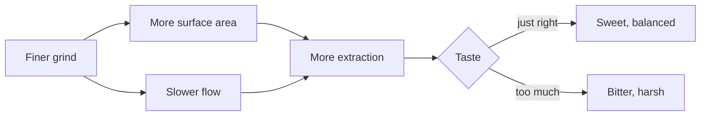

> [!NOTE]
> **Key idea:** grind size decides how much the water pulls out of the coffee, and how fast. If you can invest in only one piece of gear, make it a grinder.

## 1. Why grind size matters

Water can only dissolve what it touches. A finer grind means more total surface area → faster extraction. Fine grounds also slow the water down, so contact time gets longer too.

## 2. Grind size by method

| Method | Grind | Looks like |
| --- | --- | --- |
| Espresso | Fine | Slightly gritty flour |
| Phin | Medium-fine | Table salt |
| AeroPress | Medium-fine | Table salt |
| V60, pour-over | Medium | Fine sand |
| French press | Coarse | Sea salt |
| Cold brew | Coarse | Sea salt |

## 3. Burr or blade

- **Blade grinders** chop beans at random: some dust, some chunks. The dust over-extracts and the chunks under-extract — a cup that is bitter and sour at once.
- **Burr grinders** crush beans between two burrs at a fixed gap, giving a much more even grind. A hand burr grinder is a cheap, effective place to start.

## 4. Taste, then adjust

> [!TIP]
> **Sour, thin, short finish** → usually under-extracted → grind **finer**.
> **Bitter, harsh, drying** → usually over-extracted → grind **coarser**.

Change **one** variable at a time. Write the setting (clicks, number) in the **Brew journal** so you can repeat a great cup.

## 5. Grind right before brewing

Ground coffee loses aroma quickly because so much of it is exposed to air. Buying whole beans and grinding just before you brew is the easiest improvement you can make.
