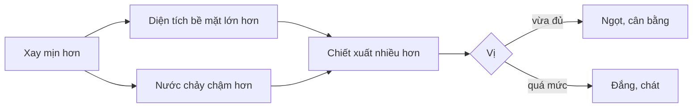

> [!NOTE]
> **Ý chính:** độ xay quyết định nước lấy được bao nhiêu chất từ bột cà phê, và lấy nhanh hay chậm. Nếu chỉ được đầu tư một món dụng cụ, hãy đầu tư máy xay.

## 1. Vì sao độ xay quan trọng

Nước chỉ hòa tan được phần bề mặt bột tiếp xúc. Xay càng mịn, tổng diện tích bề mặt càng lớn → chiết xuất càng nhanh. Đồng thời bột mịn làm nước chảy qua chậm hơn, nên thời gian tiếp xúc cũng dài ra.

## 2. Độ xay theo cách pha

| Cách pha | Độ xay | So sánh |
| --- | --- | --- |
| Espresso | Rất mịn | Bột mì hơi sạn |
| Phin | Mịn vừa | Muối ăn |
| AeroPress | Mịn vừa | Muối ăn |
| V60, pour-over | Vừa | Cát mịn |
| French press | Thô | Muối hột |
| Cold brew | Thô | Muối hột |

## 3. Lưỡi đĩa hay lưỡi dao

- **Máy xay lưỡi dao** (blade) chặt hạt ngẫu nhiên: vừa có bụi mịn vừa có mảnh to. Phần mịn bị chiết quá, phần to bị chiết thiếu — ly cà phê vừa đắng vừa chua.
- **Máy xay lưỡi đĩa** (burr) nghiền hạt giữa hai đĩa với khoảng cách cố định, cho bột đều hơn nhiều. Máy xay tay lưỡi đĩa là lựa chọn rẻ mà hiệu quả để bắt đầu.

## 4. Đọc vị để chỉnh độ xay

> [!TIP]
> **Chua, loãng, hậu vị ngắn** → thường là chiết xuất thiếu → xay **mịn hơn**.
> **Đắng, chát, khô miệng** → thường là chiết xuất quá → xay **thô hơn**.

Mỗi lần chỉ đổi **một** biến số. Ghi lại độ xay (số click, nấc) vào **Nhật ký pha** để lần sau lặp lại đúng ly ngon.

## 5. Xay ngay trước khi pha

Bột cà phê mất hương rất nhanh vì diện tích tiếp xúc không khí lớn. Mua hạt nguyên và xay ngay trước khi pha là cải thiện dễ thấy nhất bạn có thể làm.
