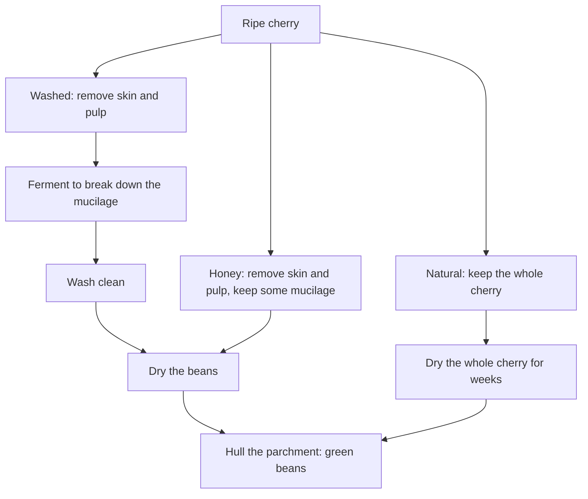

> [!NOTE]
> **Key idea:** a coffee bean is the seed of a fruit. Processing removes the fruit and dries the seed. Whether the fruit comes off early or late has a big effect on what ends up in your cup.

## 1. Anatomy of a coffee cherry

From the outside in: **skin** → **pulp** → sweet, sticky **mucilage** → **parchment** → **green bean**. Each cherry usually holds two seeds, flat sides facing each other.

## 2. The three main methods

| | Washed | Honey | Natural |
| --- | --- | --- | --- |
| Fruit left on while drying | None | Some mucilage | The whole cherry |
| Typical taste | Clean, clear, bright acidity | Sweet, rounded, medium acidity | Sweet, fruity, heavy body |
| Risk | Uses a lot of water | Must be turned evenly while drying | Easy to over-ferment: boozy or musty |

For honey coffees, producers often say *yellow*, *red* or *black honey* depending on how much mucilage is kept and how it dries — darker usually means sweeter and closer to a natural.

## 3. Anaerobic fermentation and other experiments

Many farms now ferment cherries or beans in sealed, low-oxygen tanks before drying. This can create very loud notes (tropical fruit, wine, spice). Some people love it; others find it "no longer tastes like coffee" — tasting is the only way to know.

## 4. A tasting idea

Buy two bags from the same origin but different processes (say, Ethiopia washed and Ethiopia natural), brew them identically and taste side by side. Log the notes in your **Journal** and watch the **Fruity** family show up more in the natural.
