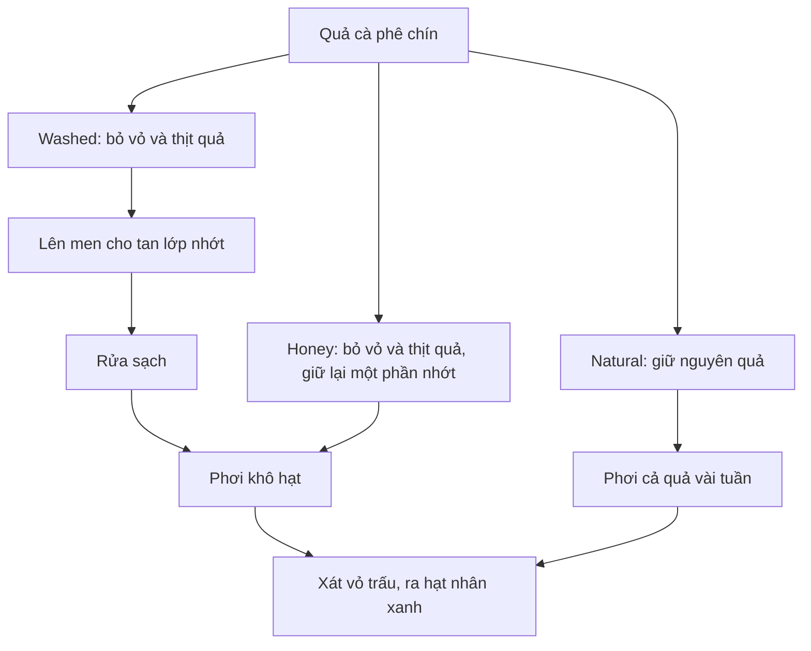

> [!NOTE]
> **Ý chính:** hạt cà phê là hạt của một loại quả. Sơ chế là bước bỏ phần thịt quả và làm khô hạt. Thịt quả được bỏ sớm hay muộn ảnh hưởng mạnh tới vị trong ly.

## 1. Cấu tạo trái cà phê

Từ ngoài vào trong: **vỏ** → **thịt quả** → lớp **nhớt** (mucilage) ngọt và dính → **vỏ trấu** → **hạt nhân**. Mỗi quả thường có hai hạt quay mặt phẳng vào nhau.

## 2. Ba cách sơ chế chính

| | Washed (ướt) | Honey | Natural (khô) |
| --- | --- | --- | --- |
| Phần quả còn lại khi phơi | Không | Một phần lớp nhớt | Cả quả |
| Vị thường gặp | Sạch, trong, chua rõ | Ngọt, tròn vị, chua vừa | Ngọt, đậm mùi trái cây, thân dày |
| Rủi ro | Cần nhiều nước | Phải đảo đều khi phơi | Dễ lên men quá, ra vị rượu hoặc mốc |

Với honey, nhà sản xuất thường gọi *yellow*, *red*, *black honey* theo lượng nhớt giữ lại và cách phơi — càng sẫm thường càng ngọt và càng giống natural.

## 3. Sơ chế lên men (anaerobic) và các thử nghiệm mới

Nhiều nông trại ủ quả hoặc hạt trong thùng kín, ít oxy, trước khi phơi. Cách này có thể tạo ra nốt hương rất mạnh (trái cây nhiệt đới, rượu vang, gia vị). Có người mê, có người thấy "không còn giống cà phê" — nếm thử là cách duy nhất để biết.

## 4. Gợi ý nếm

Mua hai túi cùng nguồn gốc nhưng khác sơ chế (ví dụ Ethiopia washed và Ethiopia natural), pha giống hệt nhau, nếm cạnh nhau. Ghi các nốt hương vào **Nhật ký** và để ý nhóm **Trái cây** xuất hiện nhiều hơn ở ly natural.
